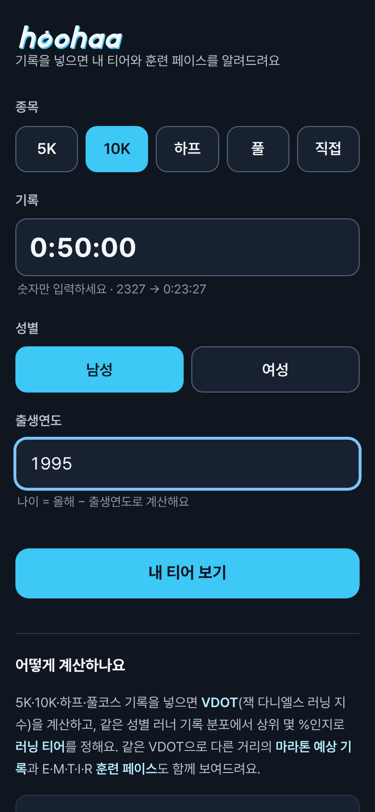
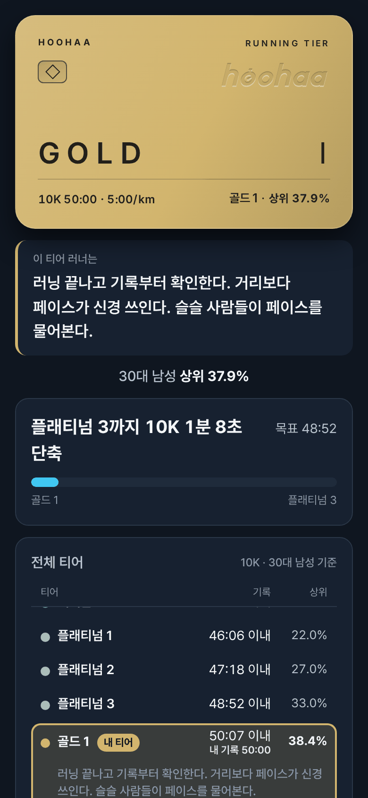
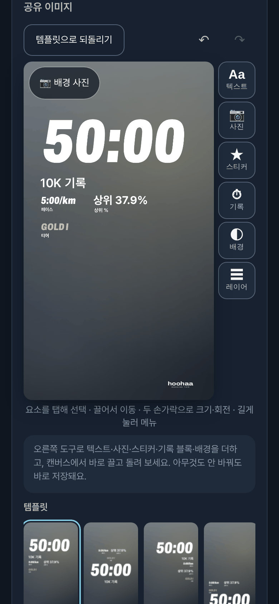

<p align="center">
  
</p>
<h1 align="center">hoohaa · 러닝 티어</h1>
<p align="center">5K·10K·하프·풀코스 기록 하나로 <b>아이언부터 챌린저까지</b> 내 러닝 티어를 확인해요.</p>

<p align="center">
  <a href="https://hoohaa.run"></a>
  
  
</p>

<p align="center">
  <a href="https://hoohaa.run"></a>
</p>

무료이고 로그인도 필요 없으며, 모든 계산은 브라우저 안에서 이뤄져요. 👉 **https://hoohaa.run**

## 스크린샷

<p align="center">
  
  
  
</p>
<p align="center"><sub>입력 화면 · 결과 화면 (10K 50:00, 30대 남성 → 골드 1, 상위 37.9%) · 공유 이미지 편집기</sub></p>

## 주요 기능

| 기능 | 내용 |
|---|---|
| 러닝 티어 | 성별·나이대 기준 24단계 티어(아이언~다이아몬드 각 3→1단계, 마스터·그랜드마스터·챌린저)와 상위 % |
| 다음 티어까지 | 다음 티어 목표 기록, 줄여야 할 시간, 진행 막대 |
| 전체 티어표 | 내 종목·성별·나이대 기준 24단계 기준 기록과 상위 % |
| VDOT | 잭 다니엘스 러닝 지수(VO2max 추정치) |
| 예상 기록 | 같은 VDOT으로 계산한 5K·10K·하프·풀 예상 기록과 페이스 |
| 훈련 페이스 | E·M·T·I·R 페이스와 설명 |
| 공유 이미지 편집기 | 템플릿(인증샷·센터·상위 % 크게·투명·블랙 등), 텍스트·사진·스티커·기록 블록·배경·글꼴·색 편집, 실행취소/다시실행, 내 템플릿 저장 |
| 인물 뒤로 | 사진 속 인물을 기기 안에서 분리해 글자 앞에 세우는 효과(MediaPipe, 처음 쓸 때만 로드) |
| 저장 / 공유 | PNG 저장, 지원 기기에서는 공유 시트로 바로 전송 |

그 밖에 종목·기록별 안내 페이지(5K, 10K, 하프, 풀, 페이스 계산기, 예상 기록, 스플릿, VDOT, VO2max 등)도 있어요.

## 사용 방법

1. 종목을 골라요: 5K · 10K · 하프 · 풀 · 직접 입력(1.5~100km)
2. 기록을 입력해요
3. 성별과 출생연도를 입력해요 (10~100세 지원)
4. **내 티어 보기**를 눌러 결과를 확인해요
5. 공유 이미지를 꾸민 다음 **저장** 또는 **공유**를 눌러요

> 팁: `?ev=5k|10k|half|full` 주소를 쓰면 해당 종목이 미리 선택돼요. 예: `https://hoohaa.run/?ev=10k`

## 티어 계산 방식

성별·나이대에 맞춘 기준 기록과 비교해 티어를 정하고, 상위 %를 함께 보여줘요.

<details>
<summary><b>계산 과정 자세히 보기</b></summary>

1. **VDOT 계산**: 거리와 기록으로 Daniels/Gilbert 공식의 VDOT을 구해요.
2. **나이 보정**: 30대 기준 티어 경계 기록에 성별·나이대별 보정 배수(1 이상)를 곱해요. 나이대는 20대 이하 / 30대 / 40대 / 50대 / 60대 이상이에요.
3. **거리 보간**: 표준 거리(5K·10K·하프·풀)가 아닌 거리는 가까운 두 거리의 경계값을 VDOT으로 바꾼 뒤 로그 거리 기준으로 보간해요.
4. **티어 결정**: 내 기록이 어느 경계 사이에 있는지로 24단계 중 티어를 정해요.
5. **상위 %**: 경계 기록과 목표 상위 % 사이를 로그 시간–프로빗 척도로 보간해 계산해요 (0.1% 미만이면 "상위 0.1% 이내").
6. **검증**: 세계기록 × 0.98보다 빠르거나 VDOT이 85를 넘는 기록은 계산하지 않아요.

예시 – 10K · 30대 남성 기준 각 티어 진입 기록:

| 티어 | 10K 기록 | 누적 상위 |
|---|---|---|
| 챌린저 | 33:31 이내 | 0.1% |
| 그랜드마스터 | 35:25 이내 | 0.5% |
| 마스터 | 37:41 이내 | 2% |
| 다이아몬드 | 41:32 이내 | 8% |
| 에메랄드 | 45:03 이내 | 18% |
| 플래티넘 | 48:52 이내 | 33% |
| 골드 | 52:58 이내 | 52% |
| 실버 | 58:54 이내 | 72% |
| 브론즈 | 1:05:28 이내 | 88% |
| 아이언 | 모든 완주 기록 | 누구나 |

</details>

> 예상 기록과 VDOT은 공식으로 계산한 참고값이에요. 실제 기록은 훈련량·코스·날씨에 따라 달라질 수 있어요.

## 개인정보와 데이터

- 계정과 서버가 없어요. 계산은 브라우저 안에서 끝나요.
- 다음 방문을 위해 이 기기에만 저장돼요. [개인정보](privacy/) 페이지에서 지울 수 있어요.
  - `localStorage`의 `runtier:` 키: 마지막 입력값, 편집 중인 공유 이미지, 내 템플릿, 내 스타일, 글꼴 즐겨찾기·최근 목록
  - `IndexedDB`(`hoohaa` / `photos`): 공유 이미지에 넣은 사진 (긴 변 1600px 이하)
- 공유 이미지에는 나이와 성별이 표시되지 않아요.
- 인물 분리는 기기 안에서만 처리돼요. 모델은 처음 ‘인물 뒤로’를 쓸 때 받아 와요.
- 날씨 스티커를 직접 누를 때만 위도·경도(소수 셋째 자리)와 날짜·시각, 또는 입력한 장소 이름이 Open-Meteo로 나가요. 그 값은 저장하지 않아요.

## 기술

- 프레임워크와 배포용 빌드가 없는 정적 사이트예요. 브라우저 ES 모듈이 소스 그대로 올라가요.
- 계산은 `src/engine/` 한곳에 있어요. 홈과 계산기 페이지가 같은 모듈을 써요.
- `/`는 웹 홈(계산기 + 안내 글)이고, `/app/`는 설치용 진입점이에요. 매니페스트 `start_url`은 `/app/`예요.
- 공유 이미지의 스티커·템플릿은 결과를 열 때 불러와요. 카드 장식 CSS도 그때 적용해요.
- Canvas로 공유 이미지를 그리고, Web Share API로 공유해요.
- 인물 분리: MediaPipe Tasks Vision + selfie_segmenter (Apache-2.0, `seg/`)
- 서비스 워커(`sw.js`)는 앱 셸, 엔진, 아이콘, 카드 스타일을 캐시해요. 안내 글 전체는 캐시하지 않아요.

## 로컬에서 실행하기

```bash
git clone https://github.com/BeomhyunPark/hoohaa.git
cd hoohaa
python3 -m http.server 8000
# http://localhost:8000/       웹 홈
# http://localhost:8000/app/   앱 진입점
```

`seg/`의 모듈과 wasm 파일은 `file://`로는 불러오지 못할 수 있으니, 로컬 서버로 여는 걸 추천해요.

## 배포 (GitHub Pages)

- `main` 브랜치 루트를 GitHub Pages로 배포해요. 빌드 단계는 없어요.
- `CNAME`으로 커스텀 도메인 `hoohaa.run`을 연결하고, `.nojekyll`로 Jekyll 처리를 꺼 두었어요.
- 검색엔진용 `sitemap.xml`과 `robots.txt`, 네이버 사이트 인증 파일이 들어 있어요.

## 폴더 구조

```
hoohaa/
├── index.html              # 웹 홈. 계산기 + 안내 글
├── app/index.html          # 설치·스토어용 진입점. 안내 글 없음
├── privacy/ support/       # 개인정보, 고객지원
├── src/engine/             # 티어 계산. DOM·네트워크·저장소 없음
├── src/app/boot.js         # 입력 화면
├── src/editor/             # 공유 편집기. 결과 이후에 로드
├── src/storage/ src/net/   # 기기 저장, Open-Meteo
├── src/styles/             # 앱 레이아웃, 티어 카드
├── sw.js  manifest.webmanifest
├── 5k/ 10k/ half/ full/    # 종목·목표 기록별 안내 페이지
├── age/ men/ women/ guide/ tier-guide/
├── pace/ pace-calculator/ predictor/ splits/ vdot/ vo2max/
├── seg/  fonts/  icons/
├── sitemap.xml  robots.txt  CNAME  .nojekyll
└── naver*.html
```
