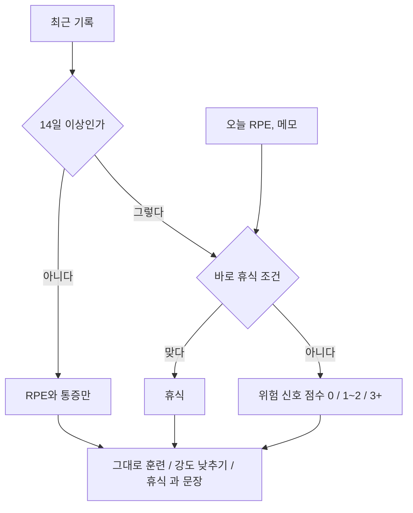

# 오늘의 컨디션

목록은 [../index.md](../index.md)다. 규칙으로 판단한다. 규칙은 [../rules.md](../rules.md)의 1절이다. 보류는 [../withhold.md](../withhold.md)다.

## 하는 일

**결정.** 최근 기록과 오늘의 입력으로 {그대로 훈련, 강도 낮추기, 휴식} 중 하나와, 그렇게 고른 이유를 보여 준다. 문장은 [copy.md](copy.md)다.

**결정.** 기록이 14일보다 적으면 RPE와 통증만 보고, "기록이 2주 쌓이면 더 정확해져요."를 붙인다. 기준값이 7일보다 적은 신호는 쓰지 않는다. RPE도 메모도 없으면 "오늘은 판단하지 않아요."다.

**결정.** 최근 기록은 14일치다. 7일이 아니다.

**결정.** 건강 앱에서 읽은 항목, 체감 피로, 메모가 있으면 그 말을 JSON으로 넣는다. 메모는 통증 키워드가 있는지만 본다. 진단으로 바꾸지 않는다. 통증이 있으면 휴식이고, "계속되면 진료를 받아 보세요."를 보여 준다.

**결정.** 컨디션 문장 옆에 "의학적인 진단은 아니에요."를 둔다.

## 하지 않는 일

코칭 문장은 템플릿만 쓴다. 문장은 [copy.md](copy.md)에 있다. 이 판단의 결과는 내일 훈련 규칙의 첫 입력이다(휴식 → 휴식, 강도 낮추기 → E). [tomorrow.md](tomorrow.md)를 본다.

## 도식

## 아직 정할 내용

없다. 숫자는 [../rules.md](../rules.md)에 있다. 바꾸려면 러닝 코치와 정한다.

## 같이 볼 문서

기록 항목은 [health-import.md](health-import.md)다. 규칙은 [../rules.md](../rules.md)다.
