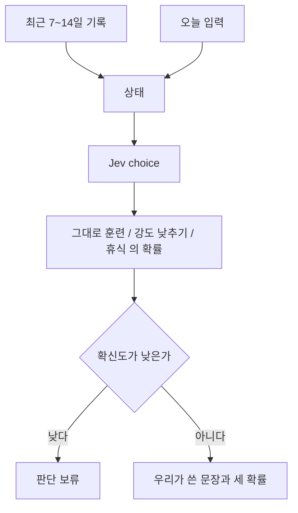

# 오늘의 컨디션

색인 [../index.md](../index.md). Jev choice. 보류는 [../withhold.md](../withhold.md).

## 하는 일

**말한 것.** 최근 7~14일 기록과 오늘 입력으로 {그대로 훈련, 강도 낮추기, 휴식} 중 하나와 각 확률을 보여 준다. 확신도가 낮으면 판단 보류.

## 하지 않는 일

코칭 문장을 Jev가 짓지 않는다. 문장은 [copy.md](copy.md)에 있다. 내일 훈련의 입력이 이 답이 되면 한 호출에 넣을 수 없다. [tomorrow.md](tomorrow.md)를 본다.

## 도식

## 제안

의료 조언이 아니라는 한 줄을 문장 옆에 둔다. 진단이 아니다.

## 빈 칸

오늘 입력이 무엇인지. 7일과 14일 중 어느 구간을 쓰는지. 보류 기준 숫자.

## 손댈 때

기록 필드는 [health-import.md](health-import.md). 호출은 [../engine.md](../engine.md).
