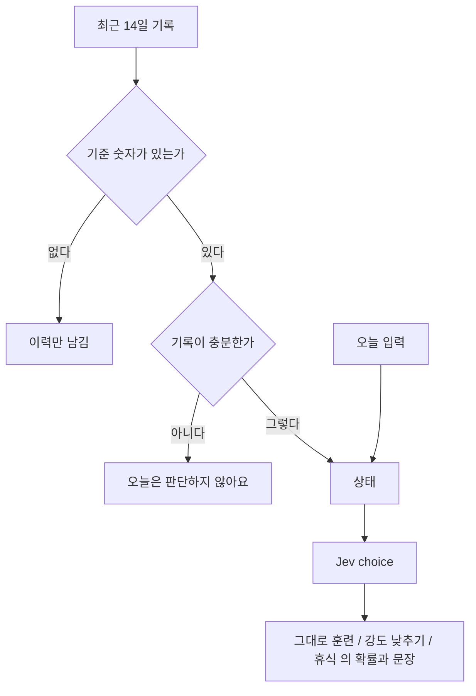

# 오늘의 컨디션

목록은 [../index.md](../index.md)다. Jev의 choice를 쓴다. 보류는 [../withhold.md](../withhold.md)다.

## 하는 일

**결정.** 기준이 정해져 있고 기록이 충분하면, 최근 기록과 오늘의 입력으로 {그대로 훈련, 강도 낮추기, 휴식} 중 하나와 각각의 확률을 보여 준다. 문장은 [copy.md](copy.md)다.

**결정.** 판단 보류는 충분한 기록이 쌓이지 않은 경우에 쓴다. 문장은 "오늘은 판단하지 않아요."다. 구체적인 기준 숫자는 실제 기록을 확인한 뒤 정한다. 기준이 정해지기 전에는 컨디션 판단을 하지 않고 이력만 남긴다.

**결정.** 최근 기록은 14일치다. 7일이 아니다.

**결정.** 건강 앱에서 읽은 항목, 체감 피로, 메모가 있으면 그 말을 JSON으로 넣는다. 메모를 따로 분류하거나 진단으로 바꾸지 않는다. Jev는 그 JSON을 보고 정해 둔 보기 안에서만 고른다. 그 답과 확률을 화면에 넘긴다.

**결정.** 컨디션 문장 옆에 "의학적인 진단은 아니에요."를 둔다.

## 하지 않는 일

코칭 문장은 Jev가 쓰지 않는다. 문장은 [copy.md](copy.md)에 있다. 이 판단의 결과를 내일 훈련의 입력으로 쓰지 않는다. 화면에서 이 문장을 앞에 두는 것은 입력으로 쓰는 것이 아니다. [tomorrow.md](tomorrow.md)를 본다.

## 도식

## 아직 정할 내용

기록이 충분하다고 볼 기준 숫자.

## 같이 볼 문서

기록 항목은 [health-import.md](health-import.md)다. 호출 방법은 [../engine.md](../engine.md)다.
