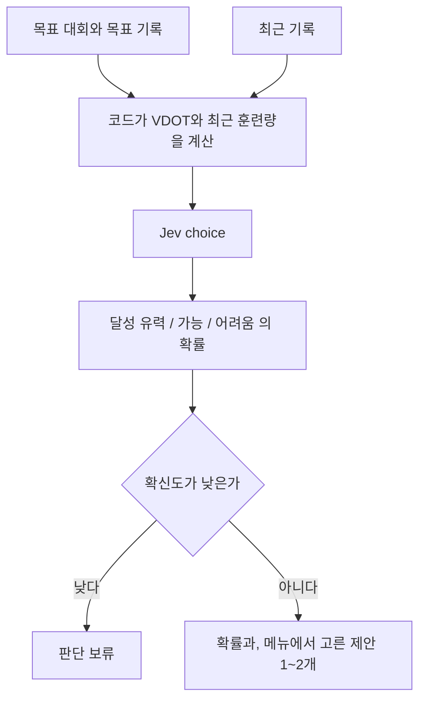

# 목표 달성

목록은 [../index.md](../index.md)다. Jev의 choice를 쓴다. 보류는 [../withhold.md](../withhold.md)다.

## 하는 일

**말한 것.** 목표 대회와 목표 기록을 넣으면, 현재 VDOT와 최근 훈련량으로 {달성 유력, 가능, 어려움}의 확률을 보여 준다. 확률을 올리는 훈련 제안 1~2개를 붙인다.

VDOT와 훈련량은 코드가 계산해서 Jev에 넘긴다. [tier-vdot.md](tier-vdot.md)를 본다. 제안 문장은 [copy.md](copy.md)와 [tomorrow.md](tomorrow.md)의 메뉴를 쓴다.

## 하지 않는 일

목표 기록에 필요한 VDOT는 Jev가 계산하지 않는다. score로 바꿀지는 아직 결정이 아니다.

## 도식

## 제안

세 단계를 순서가 있는 점수로 보고 score를 쓸 수 있다. 그렇게 바꾸기 전에는 이 문서에서 choice를 score로 고친다.

## 아직 정할 내용

목표 대회를 어떤 항목으로 받을지. 최근 훈련량을 어느 기간으로 볼지. 판단 보류의 기준 숫자.
