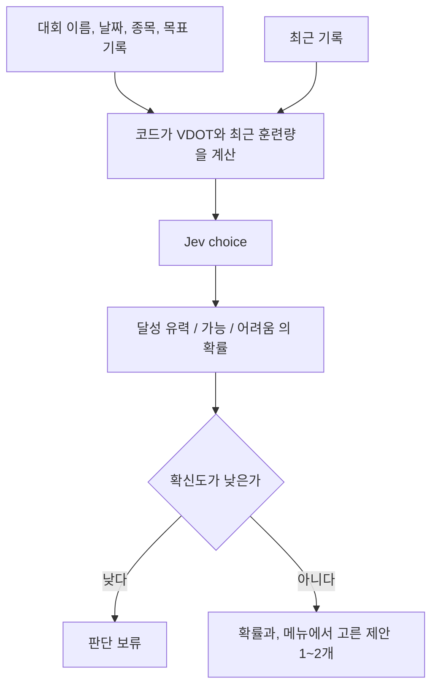

# 목표 달성

목록은 [../index.md](../index.md)다. Jev의 choice를 쓴다. 보류는 [../withhold.md](../withhold.md)다.

## 하는 일

**결정.** 목표는 {달성 유력, 가능, 어려움} 중 하나와 각각의 확률로 보여 준다. 점수로 바꾸지 않는다.

**결정.** 목표 문장은 대회 목표가 설정된 경우에만 보여 준다. 목표 없음이면 보여 주지 않는다.

**결정.** 첫 화면에서는 이렇게만 받는다. 목표는 계정에 저장하고, 운동이 끝날 때마다 다시 묻지 않는다.

목표가 있나요?

- 목표 없음
- 대회 목표

대회 목표이면 다음 네 칸이다.

| 화면 | 받는 방식 | 항목 |
|---|---|---|
| 대회 이름 | 직접 입력 | `race_name` |
| 대회 날짜 | 날짜 선택 | `race_date` |
| 목표 종목 | 5K, 10K, 하프, 풀, 기타 | `distance` |
| 목표 기록 | 시간 입력 | `target_time` |

**결정.** 최근 훈련량 기간은 사용자에게 묻지 않는다. 앱 내부 기준이고, 그 숫자는 별도로 정한다.

**말한 것.** 대회 목표를 넣으면, 현재 VDOT와 최근 훈련량으로 판단한다. 확률을 올리는 훈련 제안 1~2개를 붙인다.

VDOT와 훈련량은 코드가 계산해서 Jev에 넘긴다. [tier-vdot.md](tier-vdot.md)를 본다. 제안 문장은 [copy.md](copy.md)와 [tomorrow.md](tomorrow.md)의 메뉴를 쓴다.

## 하지 않는 일

목표 기록에 필요한 VDOT는 Jev가 계산하지 않는다.

## 도식

## 제안

최근 훈련량 기간은 14일이다. 7일은 짧고, 28일은 기록이 적을 수 있다. 숫자는 아직 결정이 아니다.

## 아직 정할 내용

최근 훈련량을 어느 기간으로 볼지. 판단 보류의 기준 숫자.
