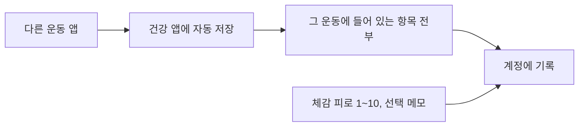

# 건강 앱 공유와 기록

목록은 [../index.md](../index.md)다. 판단 규칙을 쓰지 않는다.

## 하는 일

**결정.** 운동이 끝나면 건강 앱에 쌓인 기록을 폰이 자동으로 읽는다. 그 운동에 건강 앱이 넣어 둔 항목은 빠짐없이 가져온다. 거리, 시간, 심박, 경로만 골라 내지 않는다. 사용자가 사진, GPX, FIT를 직접 올리지 않는다. 읽은 기록은 회원 계정에 저장한다.

**말한 것.** 손수 기록 항목은 날짜, 거리, 시간, 평균 심박, 체감 피로 1~10, 수면 시간, 메모다.

## 하지 않는 일

기록을 여기서 해석하지 않는다. 티어 숫자는 [tier-vdot.md](tier-vdot.md)가, 카드는 [photo.md](photo.md)가 맡는다.

## 결정

한 운동은 어디서 가져왔는지로 구분한다. 건강 앱, 파일, 직접 입력이 같은 러닝이면 두 번 저장하지 않는다. 기록에는 가져온 곳, 그곳의 기록 번호, 가져온 시각이 들어간다. 항목 이름은 아직 정하지 않았다.

**결정.** 직접 입력한 기록은 바깥에서 받은 기록 번호가 없으므로 앱이 번호를 만들어 붙인다. 그래야 건강 앱 기록과 같은 방법으로 다시 찾을 수 있다. 번호는 저장을 누를 때 만들고, 모양은 `m-<만든 시각>-<무작위 8자>`다. 한 기기 안에서 겹치지 않으면 되고 번호에서 뜻을 읽지 않는다.

**결정.** 직접 입력에서 꼭 받는 것은 날짜, 거리, 시간이다. 심박, 케이던스 같은 자세한 항목은 선택이다. 지금 폰 앱이 받는 선택 항목은 시작 시각, 평균 심박, 평균 케이던스다. 체감 피로와 메모는 건강 앱 기록과 같은 화면에서 묻는다. 수면 시간은 아직 받지 않는다.

직접 입력한 기록은 적은 값을 고치고 기록을 지울 수 있다. 고쳐도 기록 번호는 그대로라 체감 피로와 메모가 그대로 붙어 있다. 지우면 체감 피로와 메모도 같이 지우고, 지우기 전에 한 번 묻는다. 건강 앱에서 읽은 기록은 이 앱에서 고치거나 지우지 않는다.

직접 입력한 기록의 측정값은 건강 앱에 없으므로 기기에 저장한다. 건강 앱 기록은 측정값을 기기에 복사하지 않는다. 코드는 [mobile/src/record/manual.ts](../../../mobile/src/record/manual.ts)다.

## 결정

건강 앱 저장소는 웹에서 읽을 수 없다. 기록을 자동으로 읽기로 했으므로 새 앱은 폰 앱이다. 아이폰은 애플 건강(HealthKit)을 읽고, 안드로이드는 헬스 커넥트를 읽는다.

## 결정

기록을 읽은 뒤 체감 피로를 사용자에게 한 번 묻는다. 1~10이다. 건강 앱은 몸의 느낌을 모른다.

같은 자리에서 짧은 메모도 쓸 수 있다. 필수는 아니다. 예시로 어디가 아픈지를 적을 수 있다. 진단은 아니고, 사용자가 적은 말이다. 이 값과 건강 앱 기록은 판단 규칙에 들어간다. 메모는 통증 키워드만 본다. [condition.md](condition.md)를 본다.

**결정.** 저장한 뒤에도 사용자가 체감 피로와 메모를 고칠 수 있다. 앱이 다시 묻지는 않는다. 고친 값은 같은 기록에 덮어쓴다.

**결정.** 메모의 글자 수는 제한하지 않는다.

**결정.** 기록의 시간은 멈춘 구간을 뺀 값이다. 같은 달리기는 애플 건강에서 오든 헬스 커넥트에서 오든 같은 시간과 평균 페이스로 보여야 한다. 애플 건강은 운동의 duration을 그대로 쓴다. 헬스 커넥트는 시간 항목이 없어 끝 − 시작에서 멈춘 구간(PAUSE)을 뺀다. 기록을 쓴 앱이 멈춘 구간을 남기지 않았으면 뺄 수 없다. 실제 기기에서 확인해야 한다.

**결정.** 화면의 날짜와 시각은 폰의 시간대로 적는다.

스토어와 워치의 순서는 [../platforms.md](../platforms.md)에 있다.

## 도식

## 아직 정할 내용

경로를 화면에서 어떻게 쓸지. 기록을 어느 서버에 둘지. 가져온 곳, 기록 번호, 가져온 시각의 항목 이름. 두 기록이 같은 운동인지 보는 기준. 수면 시간을 어디서 받을지. 건강 앱의 지난 운동을 목록에 어디까지 보여 줄지.

**제안.** 가져온 곳, 기록 번호, 가져온 시각의 항목 이름. 폰 앱 코드에 이렇게 두었다. 사용자가 확인하기 전까지 결정이 아니다. 코드는 [mobile/src/record/types.ts](../../../mobile/src/record/types.ts)의 `RecordOrigin`이다.

| 항목 | 이름 | 값 |
|---|---|---|
| 가져온 곳 | `origin.source` | `apple_health`, `health_connect`, `manual` |
| 그곳의 기록 번호 | `origin.sourceRecordId` | 애플 건강은 운동의 uuid, 헬스 커넥트는 운동 기록의 metadata.id. 직접 입력은 앱이 만든 번호다(위 결정) |
| 가져온 시각 | `origin.importedAt` | 폰이 읽어 온 시각, ISO 8601 UTC. 운동 시각이 아니다 |

이 제안에 함께 넣은 것: 기록 타입에 이름이 없는 원본 항목은 원본 경로를 키로 `extra`에 그대로 담는다. 같은 길이를 여러 단위로 적은 값(헬스 커넥트의 inKilometers, inMiles 등)은 미터 값이 이름 붙은 자리에 들어간 경우에만 나머지 단위를 버린다. 두 기록이 같은 운동인지 보는 기준은 정하지 않았다.

## 지금 hoohaa

로그인과 서버가 없다. 성별, 출생연도, 카드 사진은 기기에만 있다.
