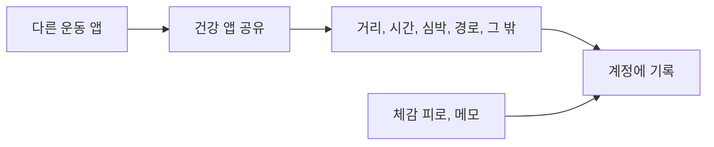

# 건강 앱 공유와 기록

목록은 [../index.md](../index.md)다. Jev를 호출하지 않는다.

## 하는 일

**말한 것.** 다른 앱에서 운동이 끝나면 건강 앱이 공유하는 데이터를 받는다. 경로도 받는다. 회원 로그인 아래 기록으로 둔다.

**말한 것.** 손수 기록 항목은 날짜, 거리, 시간, 평균 심박, 체감 피로 1~10, 수면 시간, 메모다.

## 하지 않는 일

기록을 Jev로 해석하지 않는다. 티어 숫자는 [tier-vdot.md](tier-vdot.md)가, 카드는 [photo.md](photo.md)가 맡는다.

## 결정

한 운동은 어디서 가져왔는지로 구분한다. 건강 앱, 파일, 직접 입력이 같은 러닝이면 두 번 저장하지 않는다. 기록에는 가져온 곳, 그곳의 기록 번호, 가져온 시각이 들어간다. 항목 이름은 아직 정하지 않았다.

## 제안

공유로 들어온 뒤에도 체감 피로와 메모는 한 번 묻는다. 건강 앱은 몸의 느낌을 모른다. 오늘의 컨디션은 이 값이 있을 때 판단한다. [condition.md](condition.md)를 본다.

애플 건강(HealthKit)과 헬스 커넥트는 웹에서 읽히지 않고 폰 앱에서만 읽힌다. 저장소를 직접 읽는 쪽을 주로 쓰면 새 앱은 폰 앱이어야 한다. 공유로 받은 사진, GPX, FIT는 그와 다른 길이다. 어느 쪽인지는 아직 정하지 않았으므로, 이 제안만으로 폰 앱이 확정되지는 않는다. 스토어와 워치의 순서는 [../platforms.md](../platforms.md)에 있다.

## 도식

## 아직 정할 내용

어떤 건강 앱인지. 거리·시간·심박·경로 외에 받을 데이터. 직접 입력을 남길지. 경로를 화면에서 어떻게 쓸지. 기록을 어느 서버에 둘지. 오늘의 입력이 이 항목과 같은지. 가져온 곳, 기록 번호, 가져온 시각의 항목 이름. 두 기록이 같은 운동인지 보는 기준.

## 지금 hoohaa

로그인과 서버가 없다. 성별, 출생연도, 카드 사진은 기기에만 있다.
