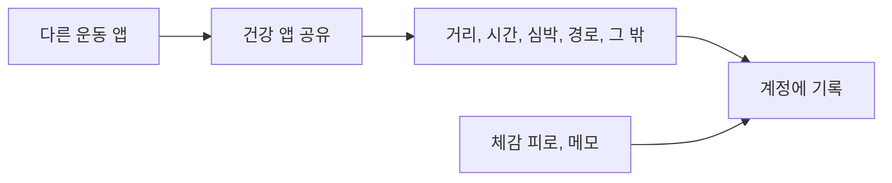

# 건강 앱 공유와 기록

색인 [../index.md](../index.md). Jev를 부르지 않는다.

## 하는 일

**말한 것.** 다른 앱에서 운동이 끝나면 건강 앱이 공유하는 데이터를 받는다. 경로도 받는다. 회원 로그인 아래 기록으로 둔다.

**말한 것.** 손수 기록 항목은 날짜, 거리, 시간, 평균 심박, 체감 피로 1~10, 수면 시간, 메모다.

## 하지 않는 일

기록을 Jev로 해석하지 않는다. 티어 숫자는 [tier-vdot.md](tier-vdot.md)가, 카드는 [photo.md](photo.md)가 맡는다.

## 제안

공유로 들어온 뒤에도 체감 피로와 메모는 한 번 묻는다. 건강 앱은 몸의 느낌을 모른다. 오늘의 컨디션은 이 값이 있을 때 판단한다. [condition.md](condition.md)를 본다.

애플 건강(HealthKit)과 헬스 커넥트는 웹에서 읽히지 않고 폰 앱에서만 읽힌다. 저장소를 직접 읽는 길을 주된 길로 두면 새 앱은 폰 앱이다. 공유 시트(사진, GPX, FIT)는 그와 다른 길이다. 어느 쪽인지는 아직 빈 칸이라, 이 제안만으로 폰 앱이 결정되지는 않는다. 스토어와 워치의 순서는 [../platforms.md](../platforms.md)에 있다.

## 도식

## 빈 칸

건강 앱이 어느 것인지. 받는 항목이 거리·시간·심박·경로 말고 무엇인지. 손수 입력을 남기는지. 경로를 화면에서 어떻게 쓸지. 기록을 어디에 두는지. 오늘 입력이 이 항목과 같은지.

## 지금 hoohaa

로그인과 서버가 없다. 성별, 출생연도, 카드 사진은 기기에만 있다.
