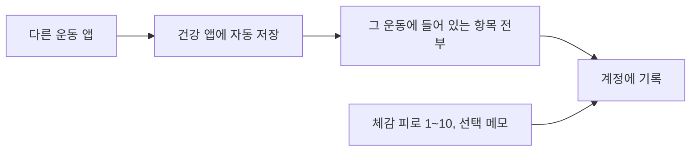

# 건강 앱 공유와 기록

목록은 [../index.md](../index.md)다. 판단 규칙을 쓰지 않는다.

## 하는 일

**결정.** 운동이 끝나면 건강 앱에 쌓인 기록을 폰이 자동으로 읽는다. 그 운동에 건강 앱이 넣어 둔 항목은 빠짐없이 가져온다. 거리, 시간, 심박, 경로만 골라 내지 않는다. 사용자가 사진, GPX, FIT를 직접 올리지 않는다. 읽은 기록은 회원 계정에 저장한다.

**말한 것.** 손수 기록 항목은 날짜, 거리, 시간, 평균 심박, 체감 피로 1~10, 수면 시간, 메모다.

## 하지 않는 일

기록을 여기서 해석하지 않는다. 티어 숫자는 [tier-vdot.md](tier-vdot.md)가, 카드는 [photo.md](photo.md)가 맡는다.

## 결정

한 운동은 어디서 가져왔는지로 구분한다. 건강 앱, 파일, 직접 입력이 같은 러닝이면 두 번 저장하지 않는다. 기록에는 가져온 곳, 그곳의 기록 번호, 가져온 시각이 들어간다. 항목 이름은 아직 정하지 않았다.

## 결정

건강 앱 저장소는 웹에서 읽을 수 없다. 기록을 자동으로 읽기로 했으므로 새 앱은 폰 앱이다. 아이폰은 애플 건강(HealthKit)을 읽고, 안드로이드는 헬스 커넥트를 읽는다.

## 결정

기록을 읽은 뒤 체감 피로를 사용자에게 한 번 묻는다. 1~10이다. 건강 앱은 몸의 느낌을 모른다.

같은 자리에서 짧은 메모도 쓸 수 있다. 필수는 아니다. 예시로 어디가 아픈지를 적을 수 있다. 진단은 아니고, 사용자가 적은 말이다. 이 값과 건강 앱 기록은 판단 규칙에 들어간다. 메모는 통증 키워드만 본다. [condition.md](condition.md)를 본다.

스토어와 워치의 순서는 [../platforms.md](../platforms.md)에 있다.

## 도식

## 아직 정할 내용

경로를 화면에서 어떻게 쓸지. 기록을 어느 서버에 둘지. 가져온 곳, 기록 번호, 가져온 시각의 항목 이름. 두 기록이 같은 운동인지 보는 기준.

## 지금 hoohaa

로그인과 서버가 없다. 성별, 출생연도, 카드 사진은 기기에만 있다.
