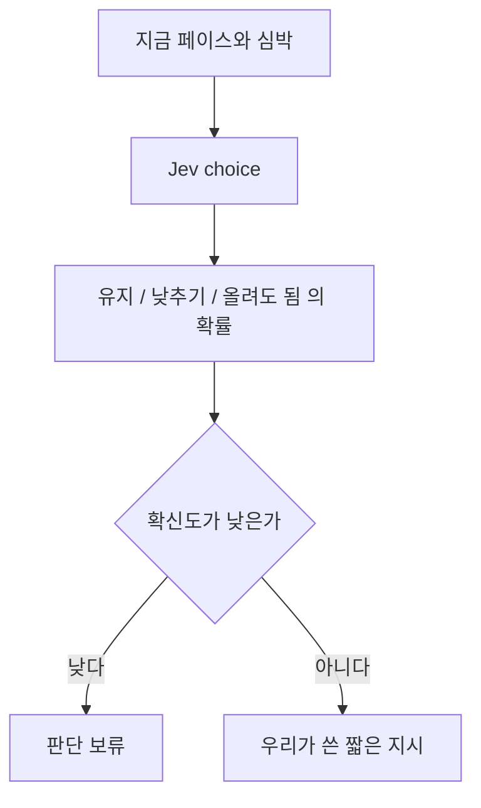

# 달리는 중 페이스

색인 [../index.md](../index.md). 후순위. Jev choice. 보류는 [../withhold.md](../withhold.md).

## 하는 일

**말한 것.** 달리는 중 페이스와 심박을 주기적으로 보내 {유지, 낮추기, 올려도 됨}을 판단한다. 지시는 우리가 쓴 짧은 문장이다.

운동이 끝난 뒤의 한 호출에 넣지 않는다. 들어오는 시점이 다르다. 워치 껍데기는 [../platforms.md](../platforms.md)를 본다. 워치가 Jev를 직접 부르지는 않는다.

## 하지 않는 일

화면이 잠긴 상태의 주기, 배터리, 통신이 끊길 때의 동작을 정하기 전에 구현하지 않는다. 1초마다 서버를 부른다고 적지 않는다. 주기는 빈 칸이다.

## 도식

## 빈 칸

주기. 심박을 어디서 받는지. 잠긴 화면에서 어떻게 보여 주는지. 통신이 끊기면 무엇을 보여 주는지. 보류 기준 숫자.
