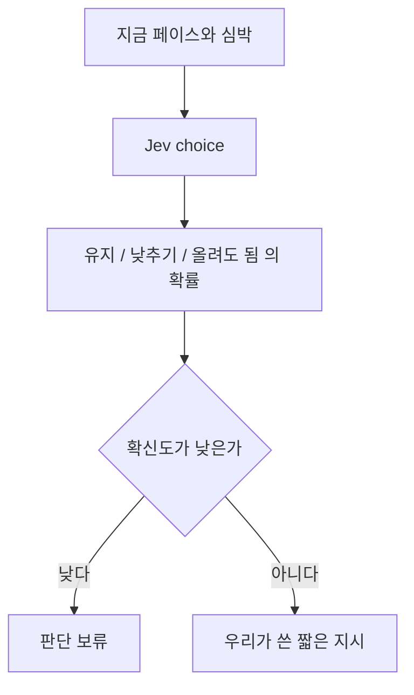

# 달리는 중 페이스

목록은 [../index.md](../index.md)다. 나중 기능이다. Jev의 choice를 쓴다. 보류는 [../withhold.md](../withhold.md)다.

## 하는 일

**말한 것.** 달리는 중 페이스와 심박을 주기적으로 보내 {유지, 낮추기, 올려도 됨}을 판단한다. 지시는 우리가 쓴 짧은 문장이다.

운동이 끝난 뒤의 호출에 넣지 않는다. 묻는 시점이 다르다. 워치 앱은 [../platforms.md](../platforms.md)를 본다. 워치가 Jev를 직접 부르지는 않는다.

## 하지 않는 일

화면이 잠긴 동안 얼마나 자주 받을지, 배터리, 통신이 끊겼을 때의 동작을 정하기 전에는 만들지 않는다. 1초마다 서버를 호출한다고 미리 적지 않는다. 주기는 아직 정하지 않았다.

## 도식

## 아직 정할 내용

데이터를 얼마나 자주 받을지. 심박을 어디에서 받을지. 잠긴 화면에서 무엇을 보여줄지. 통신이 끊기면 무엇을 보여줄지. 판단 보류의 기준 숫자.
