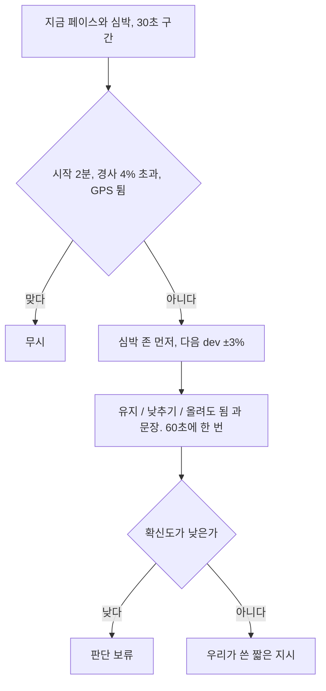

# 달리는 중 페이스

목록은 [../index.md](../index.md)다. 나중 기능이다. 규칙으로 판단한다. 규칙은 [../rules.md](../rules.md)의 4절이다. 보류는 [../withhold.md](../withhold.md)다.

## 하는 일

**말한 것.** 달리는 중 페이스와 심박으로 {유지, 낮추기, 올려도 됨}을 판단한다.

**결정.** 워치나 폰 기기 안에서 계산한다. 서버를 부르지 않는다. 통신이 끊겨도 동작한다. 지시는 우리가 쓴 짧은 문장이다. 문장은 [copy.md](copy.md)의 실시간 안내에 있다.

운동이 끝난 뒤의 호출에 넣지 않는다. 운동이 끝난 뒤 화면에서도 쓰지 않는다. 묻는 시점이 다르다. 워치 앱은 [../platforms.md](../platforms.md)를 본다. 워치가 혼자 달릴 때는 워치 안에서, 폰만 있을 때는 폰 안에서 계산한다.

## 하지 않는 일

서버를 부르지 않는다. 안내는 60초에 한 번까지다. 화면이 잠긴 동안의 센서 주기와 배터리는 플랫폼에서 정하기 전에는 만들지 않는다.

## 도식

## 아직 정할 내용

데이터를 얼마나 자주 받을지. 심박을 어디에서 받을지. 잠긴 화면에서 무엇을 보여줄지. 통신이 끊기면 무엇을 보여줄지. 판단 보류의 기준 숫자.
