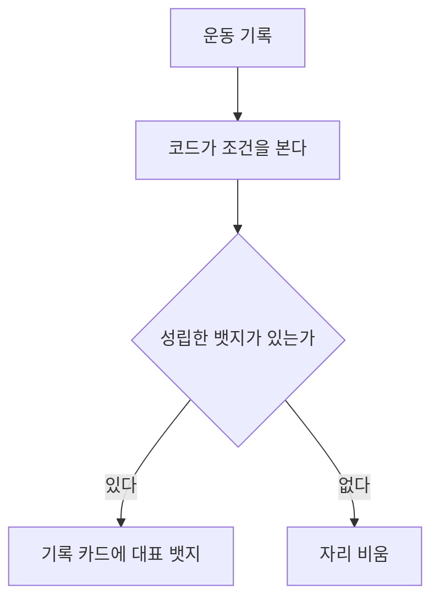

# 러너 유형

목록은 [../index.md](../index.md)다. Jev를 호출하지 않는다.

## 하는 일

**결정.** 러너 유형은 기록 카드에 붙는 작은 뱃지다. 기록, 거리, 속도, 구간, 목표, 빈도, 성장, 특이점에서 나온다. 한 기록에 여러 개가 동시에 성립할 수 있다. 카드에는 성립한 것 중 대표만 올리고, 없으면 그 자리는 비운다. 성립했는지는 코드가 본다.

카드에 올리는 작업은 [photo.md](photo.md)가 한다.

## 도식

## 아직 정할 내용

뱃지 이름. 1차로 둘 뱃지. 조건의 숫자. 카드에 몇 개까지 올릴지. 어떤 것을 대표로 볼지.
