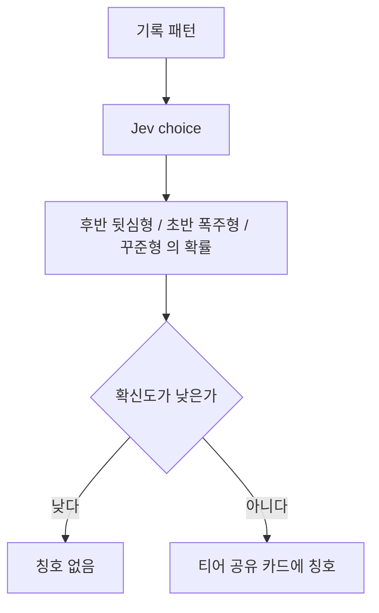

# 러너 유형

목록은 [../index.md](../index.md)다. Jev의 choice를 쓴다. 보류는 [../withhold.md](../withhold.md)다.

## 하는 일

**결정.** 유형은 세 가지다. 후반 뒷심형, 초반 폭주형, 꾸준형. 더 넣지 않는다.

후반 뒷심형은 후반이 더 빠른 기록이다. 초반 폭주형은 초반에 빠르고 뒤에 느려지는 기록이다. 꾸준형은 처음부터 끝까지 페이스가 비슷한 기록이다. 이 셋 중 하나와 각각의 확률을 보고, 티어 공유 카드에 칭호를 붙인다.

## 제안

공유 카드에 남으므로, 판단 신뢰도가 낮거나 기록이 적으면 칭호를 붙이지 않는다. 카드에 올리는 작업은 [photo.md](photo.md)가 한다.

## 도식

## 아직 정할 내용

칭호를 붙이기 전에 필요한 기록 수. 판단 보류의 기준 숫자.
