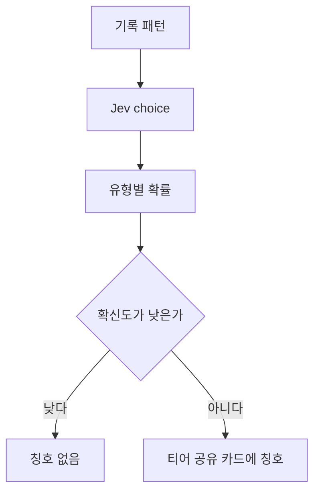

# 러너 유형

목록은 [../index.md](../index.md)다. Jev의 choice를 쓴다. 보류는 [../withhold.md](../withhold.md)다.

## 하는 일

**말한 것.** 기록 패턴으로 유형을 붙이고 티어 공유 카드에 같이 보여 준다. 예: 후반 뒷심형, 초반 폭주형, 꾸준형.

## 제안

공유 카드에 남으므로, 판단 신뢰도가 낮거나 기록이 적으면 칭호를 붙이지 않는다. 카드에 올리는 작업은 [photo.md](photo.md)가 한다.

## 도식

## 아직 정할 내용

유형의 전체 목록. 기록 패턴이 구간 기록인지, 구간 페이스인지, 여러 날의 기록인지. 칭호를 붙이기 전에 필요한 기록 수. 판단 보류의 기준 숫자.
