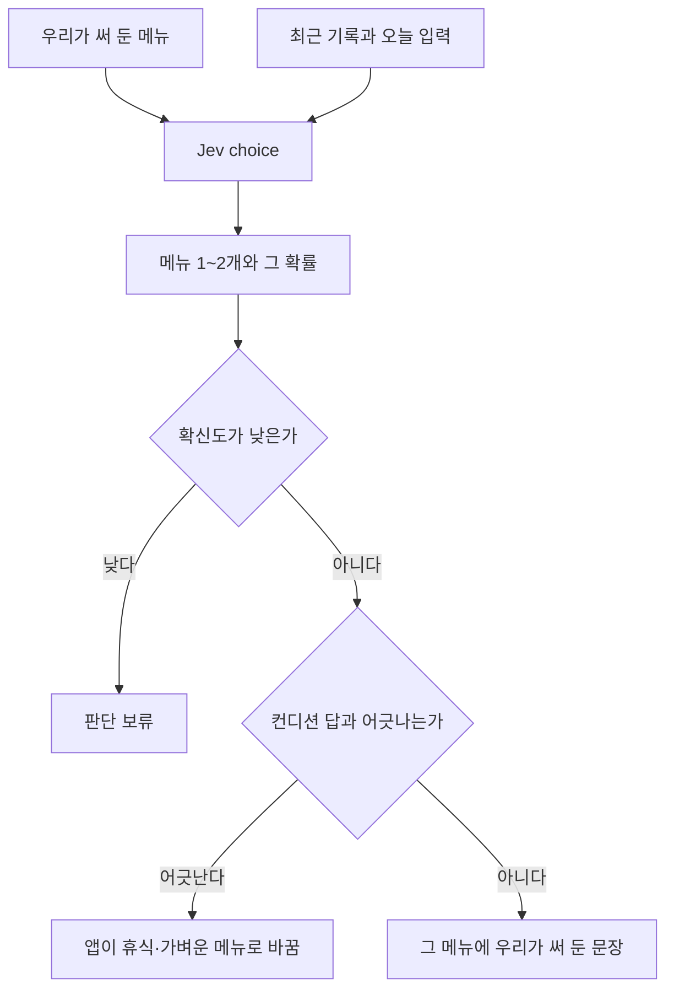

# 내일 훈련

색인 [../index.md](../index.md). Jev choice. 보류는 [../withhold.md](../withhold.md).

## 하는 일

**결정.** 문장은 우리가 쓴다. Jev는 그 문장 중에서 고르거나, 정해 둔 선택지의 확률만 낸다.

**제안.** 메뉴에서 한 번에 1~2개다. 메뉴는 지금 웹앱의 E·M·T·I·R에 맞춘다. 각 문장에 그 사용자의 VDOT로 계산한 페이스를 끼운다. 예: "이지런 40분, km당 {E 페이스}". 문장은 우리가 쓰고 숫자는 코드가 채운다. 숫자 계산은 [tier-vdot.md](tier-vdot.md), 문장 목록은 [copy.md](copy.md)다.

## 한 호출과의 관계

**사실.** 한 호출 안의 질문은 서로의 답을 보지 못한다. [../engine.md](../engine.md)를 본다.

**제안.** 그래서 내일 훈련은 오늘의 컨디션 결과가 아니라, 컨디션과 같은 원자료(최근 기록, 오늘 입력)를 보고 고른다. 앱이 두 답을 받은 뒤, 컨디션이 휴식인데 강한 메뉴가 골라지면 휴식·가벼운 메뉴로 바꾼다. 이 정리를 결정으로 바꾸기 전에는 컨디션 결과를 입력에 넣지 않는다.

## 도식

## 빈 칸

메뉴 문장. 무엇이 강한 메뉴인지. 보류 기준 숫자.

## 지금 hoohaa

`src/engine/tier.js`가 `trainingPaces`를 만든다. `src/editor/workout.js`와 편집기 카드에 E 이지, M 마라톤, T 역치, I 인터벌, R 리피티션이 있다.
