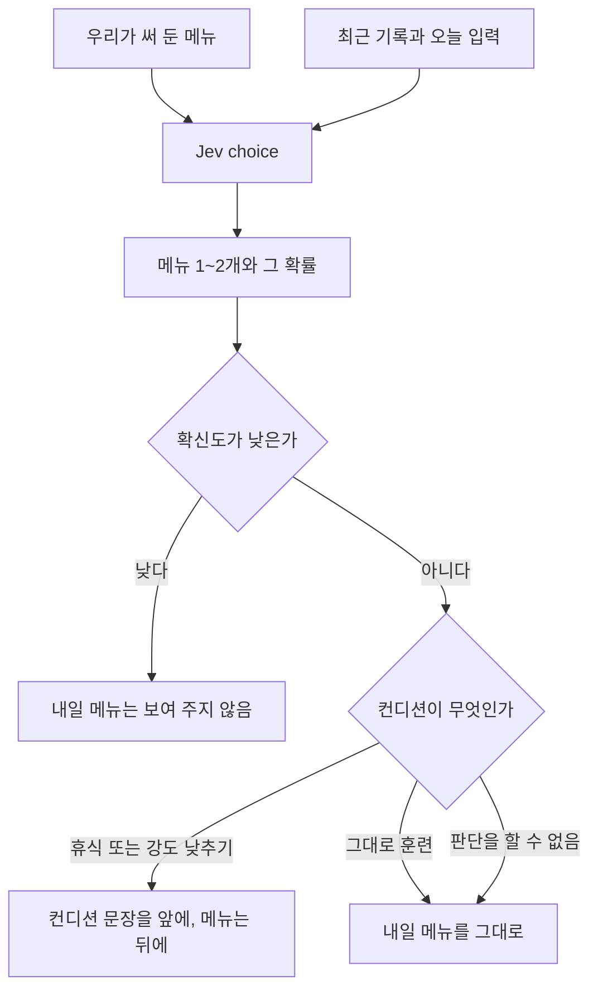

# 내일 훈련

목록은 [../index.md](../index.md)다. Jev의 choice를 쓴다. 보류는 [../withhold.md](../withhold.md)다.

## 하는 일

**결정.** 문장은 우리가 쓴다. Jev는 그 문장 중에서 고르거나, 정해 둔 선택지의 확률만 낸다.

**결정.** 강한 메뉴는 T, I, R이다. 가벼운 메뉴는 E다. M은 강한 메뉴가 아니다.

**제안.** 메뉴에서 한 번에 1~2개다. 메뉴는 지금 웹앱의 E·M·T·I·R에 맞춘다. 문장은 [copy.md](copy.md)에 있다. 페이스와 횟수, 거리는 코드가 채운다. 숫자 계산은 [tier-vdot.md](tier-vdot.md)가 한다.

## 한 호출과의 관계

**결정.** 내일 훈련은 오늘의 컨디션 결과를 입력으로 받지 않는다. 같은 운동 기록을 따로 판단한다. 컨디션이 틀려도 내일 훈련까지 같이 틀리지 않는다. [../center.md](../center.md)와 같다.

**사실.** 호출 한 번 안의 질문들은 서로의 답을 보지 못한다. [../engine.md](../engine.md)를 본다.

**결정.** 화면의 순서만 바꾼다. 두 판단의 저장 값은 받은 그대로 둔다. 내일 메뉴를 다른 메뉴로 갈아 끼우지 않는다.

**결정.** 컨디션이 휴식이거나 강도 낮추기이고 내일 메뉴를 보여 줄 수 있으면, 컨디션 문장을 앞에 두고 내일 메뉴는 뒤에 둔다. 컨디션이 그대로 훈련이거나 컨디션 판단을 할 수 없으면, 내일 메뉴를 그대로 둔다. 내일 메뉴만 보류이면 그 메뉴는 보여 주지 않는다.

## 도식

## 아직 정할 내용

판단 보류의 기준 숫자.

## 지금 hoohaa

`src/engine/tier.js`가 `trainingPaces`를 만든다. `src/editor/workout.js`와 편집기 카드에 E 이지, M 마라톤, T 역치, I 인터벌, R 리피티션이 있다.
