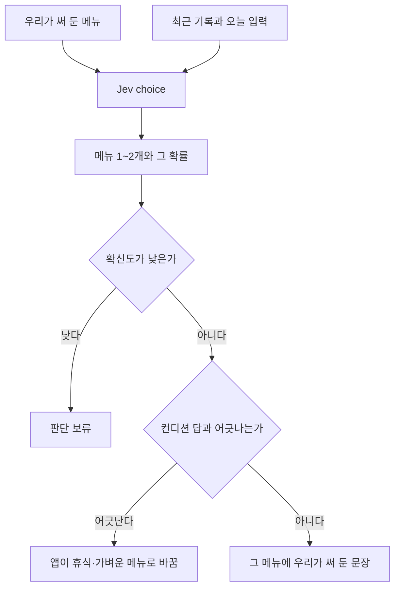

# 내일 훈련

목록은 [../index.md](../index.md)다. Jev의 choice를 쓴다. 보류는 [../withhold.md](../withhold.md)다.

## 하는 일

**결정.** 문장은 우리가 쓴다. Jev는 그 문장 중에서 고르거나, 정해 둔 선택지의 확률만 낸다.

**제안.** 메뉴에서 한 번에 1~2개다. 메뉴는 지금 웹앱의 E·M·T·I·R에 맞춘다. 각 문장에 그 사용자의 VDOT로 계산한 페이스를 끼운다. 예: "이지런 40분, km당 {E 페이스}". 문장은 우리가 쓰고 숫자는 코드가 채운다. 숫자 계산은 [tier-vdot.md](tier-vdot.md), 문장 목록은 [copy.md](copy.md)다.

## 한 호출과의 관계

**결정.** 내일 훈련은 오늘의 컨디션 결과를 입력으로 받지 않는다. 같은 운동 기록을 따로 판단한다. 컨디션이 틀려도 내일 훈련까지 같이 틀리지 않는다. [../center.md](../center.md)와 같다.

**사실.** 호출 한 번 안의 질문들은 서로의 답을 보지 못한다. [../engine.md](../engine.md)를 본다.

**제안.** 앱이 두 결과를 받은 뒤, 컨디션이 휴식인데 강한 메뉴가 골라지면 화면에서는 휴식이나 가벼운 메뉴로 바꾼다.

## 도식

## 아직 정할 내용

메뉴 문장. 어떤 메뉴를 강한 훈련으로 볼지. 판단 보류의 기준 숫자.

## 지금 hoohaa

`src/engine/tier.js`가 `trainingPaces`를 만든다. `src/editor/workout.js`와 편집기 카드에 E 이지, M 마라톤, T 역치, I 인터벌, R 리피티션이 있다.
